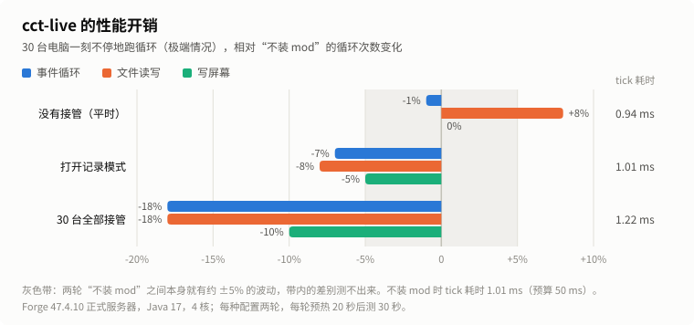
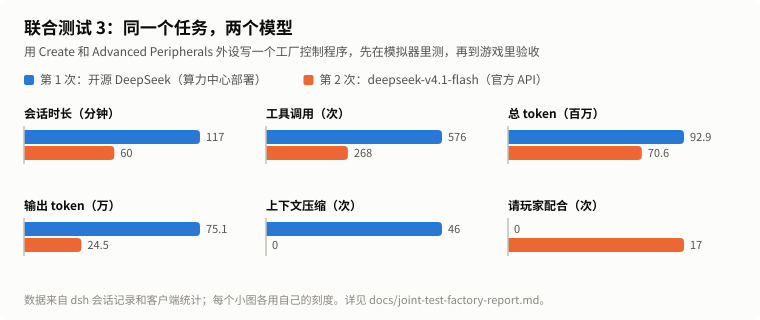

# cct-run：给 AI 用的 CC: Tweaked 测试环境

[](LICENSE) [](#ai-制作声明)

> **AI 制作声明：cct-run 采用生成式 AI 参与代码编写、测试与文档撰写。** AI 生成或修改的内容由项目维护者审阅、验证并承担最终维护责任。详见[文末](#ai-制作声明)。

cct-run 让 AI 编程助手（Claude Code、Codex、DeepSeek Harness 等）**不用启动 Minecraft**，就能直接运行 CC: Tweaked 的 Lua 程序，并拿到结构化的运行结果和完整的运行记录，用来检查和调试程序。

- 运行的是 **CC: Tweaked 1.120.2（Minecraft 1.20.1）的真实代码**，包括 Lua 运行时、ROM、BIOS、shell 和各个 API，不是自己仿写的。
- 按真实时间运行，每秒 20 刻。
- 每次运行都会输出 JSON 摘要（结果、错误和行号、最终屏幕），并把全过程记录到 trace 文件里。

模拟器测不到的内容（海龟、HTTP、真实的模组外设和真实世界），可以交给可选的 **cct-live mod**：它是一个 Forge 1.20.1 mod，在玩家同意后，让 AI 接管正在运行的游戏里的真实电脑，查看它的运行记录，也可以操作它。不需要在电脑里运行 Lua 脚本，也不需要转发服务器。见 [`mod/README.md`](mod/README.md)。

有两种接入方式：

- **MCP 服务器**（推荐）：`cct-run mcp` 是一个本地 MCP 服务器（stdio），一共 20 个工具：模拟器 4 个（`cct_run`、`cct_trace`、`cct_screen`、`cct_guide`），实机 16 个（`cct_live_*`，需要 cct-live mod）。支持 MCP 的客户端（Claude Code、Codex、Claude Desktop、DeepSeek Harness 等）配置一次即可使用。
- **命令行**：AI 通过终端直接调用 `cct-run` 命令，适合不支持 MCP 或只有终端工具的客户端。命令行只有模拟器功能。

配套的 AI Skill [CC-Tweaked_LLM_skill](https://github.com/EvergardenRoxy/CC-Tweaked_LLM_skill)（建议用 1.2.2）会告诉 AI 怎么写 CC 程序、什么时候该测试、怎么测试：有模拟器时交付前先运行，有实机工具时在你同意后到游戏里验证。

> 当前版本是 **0.2.2**（2026-10），更新内容见 [`docs/release-notes-0.2.2.md`](docs/release-notes-0.2.2.md)；历史版本：[0.2.0](docs/release-notes-0.2.0.md)、[0.1.0](docs/release-notes-0.1.0.md)。cct-live 还是原型。
>
> 0.2.2 的主要变化：fixture 里写了中文（程序会收到 `?`）时在 `notes` 里提醒；`cct_trace` / `cct_screen` 可以直接用 `run_id`；fixture 容器最多 4096 格；说明里补充了向外设发中文的写法。

---

## 能做什么

| 功能 | 说明 |
|---|---|
| 运行程序 | 在无界面的 CC 电脑上运行 `.lua` 程序，可以传命令行参数，可以设置超时 |
| 报告结果 | `ok` / `error` / `timeout` / `shutdown` / `reboot`，并给出对应的退出码 |
| 定位错误 | 语法错误和运行时错误都给出文件名、行号、错误信息和调用栈，与游戏里显示的一致；“Too long without yielding”也能复现（约 7 秒） |
| 内存上限 | 每次运行最多使用约 1 GB 内存；超出时以 `out_of_memory` 结束（退出码 4）并指出出错行，不会拖垮电脑；摘要里给出内存峰值 |
| 屏幕内容 | 程序结束时电脑屏幕和每台显示器上的文字；滚出屏幕的行也有记录 |
| 全程记录（trace） | 每个事件、每次外设调用及其返回值、红石输出、屏幕变化都带时间（第几刻）记录下来，可以按类型、时间段、外设筛选查询 |
| 回放屏幕 | 查询任意一刻电脑或显示器上显示的内容 |
| 模拟外设和世界 | 用 fixture 文件布置箱子等容器、能量存储、流体存储、显示器、有线调制解调器网络、红石输入和预置文件；其他模组的外设（Create、Advanced Peripherals 等）可以用 `scripted` 类型描述：给出类型名和每个方法的返回值（数值从实机上取），调用照样记进 trace |
| 按时间注入事件 | 在指定的刻改变红石输入、修改箱子内容、改能量、发送任意事件（如按键、触摸显示器），或者按下 Ctrl+T 终止程序 |
| MCP 服务器 | `cct-run mcp`：本地 stdio MCP 服务器，模拟器的四个工具和命令一一对应；可以直接传 Lua 代码和 fixture 对象，不必先写文件；每次运行都在独立的 Java 进程里，可以同时运行多个，也可以取消 |
| 接管游戏里的电脑（cct-live） | 装了 cct-live mod 后，AI 可以按需接管真实游戏里的电脑：查看屏幕和显示器、读取运行记录（事件、外设调用、HTTP 和文件读写、`printError` 打印的错误）、输入文字、点击、读写文件、运行一段 Lua、开关机，以及用快照把电脑恢复原样。接管时聊天栏有提示，玩家随时可以收回 |
| AI 使用说明 | `cct-run guide` 打印一份写给 AI 的英文说明：使用流程、各字段含义、排查方法、常见陷阱、“测试通过”意味着什么，以及实机工具的用法（第 7 节）；可以按章节读取 |

### 一个例子

```
> bin\cct-run.bat run examples\runtime_error.lua
{
  "status": "error",
  "exit_code": 1,
  "error": {
    "phase": "runtime",
    "message": "/runtime_error.lua:4: attempt to index local 'mon' (a nil value)",
    "traceback": "stack traceback:\n\t/runtime_error.lua:4: in local 'draw'\n..."
  },
  "screen": { "size": [51, 19], "lines": [ "/runtime_error.lua:4: attempt to index local 'mon'", ... ] },
  "trace_counts": { "event": 2, "screen": 2, ... },
  "run_dir": "...\\.cct-runs\\20261016-155108-066-fb88"
  ...
}
```

然后查这次运行收到了哪些事件：

```
> bin\cct-run.bat trace latest --kind event
```

---

## 安装

需要 Java 17 或更高版本（系统默认是旧版 Java 时，cct-run 会自动找本机的 Java 17+）。简要步骤：

1. 从 [Releases](https://github.com/EvergardenRoxy/CC-Tweaked_MCP/releases) 下载 `cct-run-<版本>.zip` 并解压，例如解压到 `C:\cct-run`；
2. 运行 `bin\cct-run.bat version`（macOS / Linux：`bin/cct-run version`），能输出带 `"cc_tweaked": "1.120.2"` 的 JSON 就说明装好了；
3. 把 `cct-run mcp` 配置成 AI 客户端的 MCP 服务器，例如 Claude Code（在 cmd 里运行）：

   ```bat
   claude mcp add --scope user cct-run -- cmd /c C:\cct-run\bin\cct-run.bat mcp
   ```

**完整说明见 [安装](docs/install.md)**：Codex 和其他 MCP 客户端的配置、接管游戏里的电脑（`CCT_LIVE_DIR`）、不支持 MCP 时用命令行方式接入。

---

## 用法速查

```
cct-run run <程序.lua> [--fixture 文件] [--timeout 秒] [-- 程序参数...]
cct-run trace  <运行目录|latest> [--kind 类型] [--contains 文字] ...
cct-run screen <运行目录|latest> [--tick N] [--source term|显示器名]
cct-run guide | version | help | mcp
```

**完整说明见 [用法速查](docs/usage.md)**：全部参数、MCP 工具与命令的对应关系、退出码、内存上限设置和 fixture 示例。

---

## 还不能模拟的内容

测试通过表示程序**在这个模拟环境里**运行正确，不保证和游戏里完全一致。目前没有：

- 海龟（turtle）、口袋电脑、命令电脑；
- 真实世界（方块、区块加载、服务器卡顿）；
- HTTP / WebSocket、扬声器、打印机、磁盘驱动器、无线 / 末影调制解调器、接收调制解调器消息；
- 容器的格子限制：任何格子都能放任何物品，上限 64（真实的熔炉、模组方块有规则）；物品详情只有部分字段；
- 其他模组的外设只能用 `scripted` 描述：返回 fixture 里写的值，不模拟机器之间的联动（调高转速不会让应力跟着变，除非时间线这样安排）；
- 能量和流体只在 fixture 时间线里改变；游戏内时间固定为 0（`os.time()`、`os.day()`）；
- 磁盘容量只报告、不限制；内存上限约 1 GB（游戏里没有单台电脑的内存上限，电脑和服务器共用内存）；
- 只记录屏幕上的文字，不记录颜色；
- CC 无法显示中文，屏幕上看到的是 CC 自己的字符集。

完整的差异清单见 `handoff.md` 的 LIMITATIONS 和 DIVERGENCES 两节。

---

## 测试情况

| 平台 / 项目 | 结果 |
|---|---|
| Windows 11（PowerShell 5.1、cmd、代码页 936） | 冒烟测试 22/22：命令行、MCP 服务器（直接启动和 `cmd /c`）、内存上限、从 Java 8 自动切换、路径含空格和中文 |
| Linux | 单元测试 54/54（0.2.2）；冒烟测试全部通过；官方 MCP SDK 客户端验证通过；Java 17 / 21 / 25 均可运行 |
| macOS | 尚未测试 |
| cct-live | Linux 上的 Forge 47.4.10 开发服务器和正式服务器；Windows 单人游戏（PCL2 启动器）七次 AI 实测：MPlayer 安装脚本排错 4 轮，联合测试 3（Create 工厂控制中心）2 次，联合测试 4（Create 订单产线）1 次 |
| AI 客户端 | 命令行方式：Autoclaw、DeepSeek Harness 实测可用；MCP 方式：一次模拟器实测四步全部正确，DeepSeek Harness 等客户端实机实测 7 次可用。其他客户端的 MCP 接入结果待反馈 |

### 性能：cct-live 平时几乎没有开销

<picture>
  <source media="(prefers-color-scheme: dark)" srcset="docs/images/perf-dark.svg">
  
</picture>

| 配置 | 服务器每 tick 耗时 | 事件循环 | 文件读写 | 写屏幕 |
|---|---|---|---|---|
| 不装 mod（基准） | 1.01 ms | 8650 次/秒 | 1250 次/秒 | 33600 次/秒 |
| 装了 mod，没有接管（平时） | 0.94 ms | −1% | +8% | 0% |
| 打开记录模式 | 1.01 ms | −7% | −8% | −5% |
| 30 台全部接管 | 1.22 ms | −18% | −18% | −10% |

这是 30 台电脑一刻不停地跑循环的极端情况；普通程序大部分时间都在等待事件，实际影响会小得多。测量方法见 [`mod/README.md`](mod/README.md#性能)。

### AI 实测：联合测试 3 与 4

联合测试让一个 AI 用 Create 和 Advanced Peripherals 的外设写完整的工厂控制程序，先在模拟器里测，再到游戏里验收。联合测试 3 做了两次（工厂控制中心）；联合测试 4（订单产线：聊天下单、订单队列、过载保护、断电续跑）用和联合测试 3 第 2 次相同的模型，换上了 cct-run 0.2.0 和 Skill 1.2.0，**这也是 Skill 第一次参与的大型任务**。

<picture>
  <source media="(prefers-color-scheme: dark)" srcset="docs/images/joint-test-dark.svg">
  
</picture>

| 指标 | 联合测试 3 第 1 次 | 联合测试 3 第 2 次 | 联合测试 4 |
|---|---|---|---|
| 模型 | 开源 DeepSeek（算力中心部署） | deepseek-v4.1-flash（官方 API） | deepseek-v4.1-flash（官方 API） |
| 工具 | cct-run 0.1.0 | cct-run 0.1.0 | cct-run 0.2.0 + Skill 1.2.0 |
| 任务时长 | 117 分钟 | 60 分钟 | 38 分钟 |
| 工具调用 | 576 次 | 268 次 | 187 次 |
| 总 token | 9293 万 | 7064 万 | 4382 万 |
| 输出 token | 75.1 万 | 24.5 万 | 19.9 万 |
| 上下文压缩 | 46 次 | 0 次 | 0 次 |
| 请玩家配合 | 0 次 | 17 次 | 5 项 |
| 卡在“外设调用期间丢事件”上的时间 | 看板冻结 18 分钟、聊天指令 27 分钟 | 约 34 分钟，交付的程序仍会丢指令 | **0**：第一版就是 Skill 里的三协程结构 |
| 模组外设怎么在模拟器里测 | 没有办法 | 自己写 Lua 替身 | fixture 的 `scripted`，数值取自实机 |
| 结果 | 看板和按钮在实机可用；聊天指令、过载保护只在模拟器里测过；没有完成收尾 | 聊天指令、过载保护、拆装外设、开机自启都在游戏里验证；收尾完整 | 下单、计数、过载保护、重启续跑、触摸、拔插外设、中文收发在游戏里验证；中文回复由玩家发现乱码后修正 |

联合测试 3 和 4 的任务不同，只能粗略比较；联合测试 4 的时长只算任务部分，token 是整个会话。分析见 [`docs/joint-test-factory-report.md`](docs/joint-test-factory-report.md)、[`docs/joint-test-orders-report.md`](docs/joint-test-orders-report.md)，测试暴露的问题已在 0.2.0 和 0.2.2 处理。

每轮测试发现的问题和处理见 [`docs/test-results.md`](docs/test-results.md)；在自己的机器上测试的方法见 [`docs/testing.md`](docs/testing.md)。

---

## 从源码构建

需要 JDK 17 或更高版本：`./gradlew build` 编译并运行测试，`./gradlew :cli:distZip` 生成发布包。**完整说明见 [从源码构建](docs/building.md)**，包括 cct-live mod 的构建和 README 图表的生成。

---

## 路线图

1. ~~命令行工具、全程记录、外设模拟~~（已完成）
2. ~~旧 Java 自动切换、给 AI 的使用说明~~（已完成）
3. ~~**MCP 服务器**：本地 stdio 方式，工具和命令一一对应，每次运行启动一个独立进程（不做远程 MCP）~~（0.1.0 测试版）
4. 资源限制：~~1 GB 内存上限、内存耗尽单独作为一种结果~~（已完成）；cct-live 的 trace 超过上限后轮换、保留最新记录（0.2.0）；模拟器 trace 的大小上限、`cct-run clean` 清理旧记录（待做）
5. ~~模组外设（`scripted`）~~（0.2.0）；按需添加更多外设（熔炉格子规则、扬声器、打印机、磁盘驱动器、无线调制解调器和多电脑 rednet 等）
6. ~~**cct-live**：一个 Forge 1.20.1 mod，让 AI 按需接管真实游戏里的 CC 电脑：接管后从 Java 层记录事件、外设调用、HTTP 和文件读写、带颜色的屏幕、显示器、红石，并允许输入、点击、读写文件、运行 Lua 和开关机；平时不记录；不需要在电脑里运行 Lua 脚本，也不需要转发服务器~~（0.1.0 原型，见 [`mod/README.md`](mod/README.md)）
7. ~~和 Skill 一起做联合测试~~（[`docs/joint-test.md`](docs/joint-test.md)、[联合测试 3](docs/joint-test-factory.md)、[联合测试 4](docs/joint-test-orders.md)）
8. cct-live 后续：程序出错时的调用栈、有线网络连接的显示器、海龟的背包和燃料、海龟和口袋电脑的测试；trace 标出程序传给外设的 UTF-8 中文（联合测试 4 的建议，待定）

配套的 AI Skill：[EvergardenRoxy/CC-Tweaked_LLM_skill](https://github.com/EvergardenRoxy/CC-Tweaked_LLM_skill)。

---

## 许可证

- 本项目代码：[MPL-2.0](LICENSE)
- `engine/src/main/resources/cctrun/harness.lua` 改编自 CC: Tweaked 的 `shell.lua`，使用 CCPL（ComputerCraft Public License）
- 发布包中包含 CC: Tweaked 及其依赖，它们各自的许可证见 `LICENSES/` 和 [THIRD-PARTY-NOTICES.md](THIRD-PARTY-NOTICES.md)

本项目不是 CC: Tweaked 官方项目。CC: Tweaked 由 SquidDev 等人开发：https://github.com/cc-tweaked/CC-Tweaked

---

## AI 制作声明

**cct-run 采用生成式 AI 参与代码编写、测试与文档撰写。** 本项目的代码、测试、说明文档和 README 中的图表主要在维护者的指导下由 Claude Code 编写；AI 实测（见[测试情况](#测试情况)）中的被测 AI 则是各自的客户端和模型。

- 设计决定、功能取舍和发布由维护者负责；
- AI 生成或修改的内容由维护者审阅，并通过单元测试、Windows / Linux 冒烟测试和游戏内实测验证；
- 维护者承担最终维护责任。发现问题请提交 issue。
