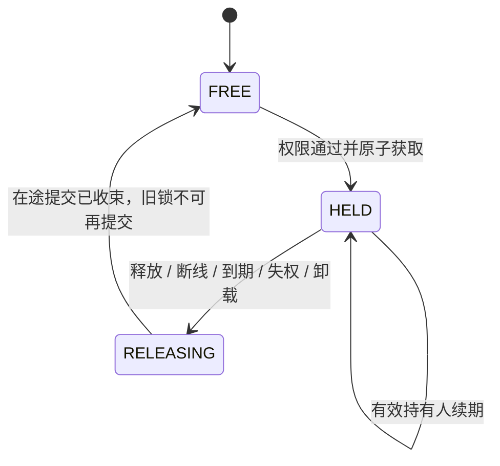

# network-test：FTB 授权与 MCP 会话互斥方案

- 整理日期：2026-10-21。
- 本项目源码基线：`2705dad03dba8b34bc56240fcfa0bb37af783bbe`；规则前版：`43c4a2d`。
- 对应待办：[NET-01～NET-06、NET-08、NET-18](network-interaction-security.md)。
- 本文区分用户规则、源码事实、推荐实现和待讨论项。`1021` 已实施只读通道上的授权与会话锁首版，见 [当前使用说明](../docs/development/network-preview.md) 和 [验证记录](verification/network-1021-2026-10-21.md)；后文推荐方案仍包含尚未实现的写入与任务生命周期。

## 一、已确定的规则

| 编号 | 规则 |
| --- | --- |
| R1 | 权限只分“有权限”和“无权限”，针对玩家与目标电脑判断，不细分查看/编辑/执行等级 |
| R2 | 已认领的 FTB 领地内，完整 MCP 授权必须同时满足方块交互和方块编辑的有效许可 |
| R3 | 未安装 FTB 领地组件，或电脑位于未认领区域时，所有玩家都可发起授权，不限定 OP |
| R4 | 未认领区域即使启用 FTB `no_wilderness`，仍按 R3 允许授权，这是本 mod 授权规则的明确例外 |
| R5 | 互斥只防止多个 MCP 会话同时操作；不拦截原生 CC:T 界面操作，也不因玩家打开界面而自动收回 MCP 控制 |
| R6 | 同一玩家启动的不同 MCP 会话同样需要互斥，不能因玩家 UUID 相同而共享控制权 |

R3 的“可发起授权”不表示自动把全部电脑数据推送给全部玩家。当前目标选择、游戏内授权及本机桥认证仍是独立环节；谁可授权与哪一个 MCP 会话当前持锁分别判断。服务器统一的功能开关、路径检查、配额及有效目标检查继续保留。

`1021` 已移除 OP/`allow_player_grants` 门槛，采用 FTB 双许可或无领地允许的判断，返回 `allowed` 并要求目标读取持有 MCP 独占锁。原生 CC:T 界面不受锁影响。当前仅开放只读数据，真实 FTB 多玩家验收仍未完成，不能据此宣称完整交互规则均已实现。

## 二、上游源码静态核对

本轮读取 FTBTeam 官方仓库的对应 Minecraft 分支，并将事实固定到以下提交。下表版本是源码属性声明，不能据此声称已经安装、编译或验证了该发行包。

| Minecraft / 加载器 | FTB Chunks 源码 | FTB Teams 源码 |
| --- | --- | --- |
| 1.20.1 / Forge | [`9103b7a`](https://github.com/FTBTeam/FTB-Chunks/tree/9103b7a5d4ee48d43d20fdac14109c7f982df25a)，`1.20.1/main`，声明 `2001.3.8` | [`f7dcaa9`](https://github.com/FTBTeam/FTB-Teams/tree/f7dcaa9c6645ff6d0e0613c48b0836572224c8a6)，`1.20.1/main`，声明 `2001.3.2` |
| 1.21.1 / NeoForge | [`a90e58e`](https://github.com/FTBTeam/FTB-Chunks/tree/a90e58e431879f5213629373ea9cde7001ebef45)，`1.21.1/main`，声明 `2101.1.22` | [`47e8c4f`](https://github.com/FTBTeam/FTB-Teams/tree/47e8c4faa797a19f41a7a351eb78ae89e41b4a26)，`1.21.1/main`，声明 `2101.1.11` |

已确认的事实：

1. 两个 Chunks 分支都公开 `FTBChunksAPI.api()`、`isManagerLoaded()`、`getManager()`、`ClaimedChunkManager.getChunk(ChunkDimPos)` 和 `shouldPreventInteraction(...)`。
2. 保护类型中有 `Protection.INTERACT_BLOCK` 与 `Protection.EDIT_BLOCK`，对应不同团队属性。不能把交互许可直接当作编辑许可。
3. `ChunkTeamDataImpl.canPlayerUse` 会根据 `PUBLIC`、`ALLIES`、`PRIVATE` 处理访问；盟友还受 `ALLY_MODE` 影响。只比较玩家是否同队会漏掉实际设置。
4. `canPlayerUse` 本身不是完整保护入口；通用保护检查还处理保护关闭、显式保护绕过、方块标签等。两个分支的具体实现顺序有差异，应按版本验证，不自己拼接一个声称通用的判定。
5. `shouldPreventInteraction` 内部使用 `player.level()` 查找领地，`Protection` 的方块判定也从玩家世界读取方块状态。直接传入其他维度电脑的坐标会查错世界。
6. Chunks 的两个加载器元数据都要求 FTB Teams、FTB Library 和 Architectury。仅有 Teams 无法提供领地位置判定；组件存在但初始化失败，不应伪装成“未安装”。
7. `ClaimedChunkEvent` 的 BEFORE 事件可能用于模拟操作，源码明确要求更新 mod 状态时使用 AFTER 事件。Teams 有团队、盟友及属性变化事件，可研究用于权限缓存失效。

源码依据：

| 事实 | 1.20.1 | 1.21.1 |
| --- | --- | --- |
| 公开管理器接口 | [ClaimedChunkManager](https://github.com/FTBTeam/FTB-Chunks/blob/9103b7a5d4ee48d43d20fdac14109c7f982df25a/common/src/main/java/dev/ftb/mods/ftbchunks/api/ClaimedChunkManager.java#L55) | [ClaimedChunkManager](https://github.com/FTBTeam/FTB-Chunks/blob/a90e58e431879f5213629373ea9cde7001ebef45/common/src/main/java/dev/ftb/mods/ftbchunks/api/ClaimedChunkManager.java#L55) |
| 交互/编辑保护类型 | [Protection](https://github.com/FTBTeam/FTB-Chunks/blob/9103b7a5d4ee48d43d20fdac14109c7f982df25a/common/src/main/java/dev/ftb/mods/ftbchunks/api/Protection.java#L29) | [Protection](https://github.com/FTBTeam/FTB-Chunks/blob/a90e58e431879f5213629373ea9cde7001ebef45/common/src/main/java/dev/ftb/mods/ftbchunks/api/Protection.java#L30) |
| 隐私、成员和盟友判定 | [ChunkTeamDataImpl](https://github.com/FTBTeam/FTB-Chunks/blob/9103b7a5d4ee48d43d20fdac14109c7f982df25a/common/src/main/java/dev/ftb/mods/ftbchunks/data/ChunkTeamDataImpl.java#L280) | [ChunkTeamDataImpl](https://github.com/FTBTeam/FTB-Chunks/blob/a90e58e431879f5213629373ea9cde7001ebef45/common/src/main/java/dev/ftb/mods/ftbchunks/data/ChunkTeamDataImpl.java#L276) |
| 通用检查、绕过及维度来源 | [ClaimedChunkManagerImpl](https://github.com/FTBTeam/FTB-Chunks/blob/9103b7a5d4ee48d43d20fdac14109c7f982df25a/common/src/main/java/dev/ftb/mods/ftbchunks/data/ClaimedChunkManagerImpl.java#L200) | [ClaimedChunkManagerImpl](https://github.com/FTBTeam/FTB-Chunks/blob/a90e58e431879f5213629373ea9cde7001ebef45/common/src/main/java/dev/ftb/mods/ftbchunks/data/ClaimedChunkManagerImpl.java#L202) |
| 领地变更事件及模拟边界 | [ClaimedChunkEvent](https://github.com/FTBTeam/FTB-Chunks/blob/9103b7a5d4ee48d43d20fdac14109c7f982df25a/common/src/main/java/dev/ftb/mods/ftbchunks/api/event/ClaimedChunkEvent.java) | [ClaimedChunkEvent](https://github.com/FTBTeam/FTB-Chunks/blob/a90e58e431879f5213629373ea9cde7001ebef45/common/src/main/java/dev/ftb/mods/ftbchunks/api/event/ClaimedChunkEvent.java) |

## 三、推荐的授权判定流程

所有查询在服务端使用网络上下文对应的真实玩家和实际目标电脑；不接受客户端自报团队、是否有权限或电脑所属维度作为事实。

```text
校验玩家连接、电脑实例和服务器统一运行条件
  ├─ 没有安装 FTB Chunks → 允许发起授权（R3）
  └─ 已安装 FTB Chunks
       ├─ API 未就绪 / 查询失败 / 版本不兼容 → 明确返回服务不可用（推荐）
       └─ 按电脑实际维度和区块查询领地
            ├─ 未认领 → 允许发起授权（R3、R4，不调用荒野拒绝逻辑）
            └─ 已认领 → 交互有效允许 AND 编辑有效允许 → 有权限
                       其中任一拒绝 → 无权限
```

“服务不可用”是不能完成判定的运行错误，不新增第三种玩家权限。推荐不把故障降级成全员允许。已认领区的管理员绕过应遵循所选 FTB 有效判定语义，不另加“只要 OP 就全部允许”的旁路；是否另设显式管理员操作入口仍待讨论。

同维度情况下，可以研究分别调用管理器的 `shouldPreventInteraction`，使用 `INTERACT_BLOCK` 和 `EDIT_BLOCK`；只有两个返回值都表示不阻止时才允许。不能把 `ProtectionPolicy.CHECK` 当作最终允许，也不能只调用 `canPlayerUse` 就声称完整遵循 FTB。

跨维度仍待定：一种较小的首版范围是先支持玩家与已认领电脑同维度的保护查询；另一种是为目标世界实现并验证与上游语义等价的适配。不能临时修改真实玩家所在世界或伪造玩家来绕过 API 的维度限制。源码核对尚未解决该适配问题。

权限判定需在授权、获取控制锁和实际副作用提交前重新确认。领地转移、团队/盟友/属性变化、电脑移动和管理员绕过变化应触发失效；事件失效加提交前复查，避免只依赖长时间缓存。取消认领后按 R3 可重新授权，但旧任务/旧锁仍需失效或重校验，不能静默继承新授权。

FTB 是建议采用的可选集成：分别为 Forge / NeoForge 加载兼容层，未安装时不能因静态引用 FTB 类而导致 mod 加载失败。已安装时必须验证依赖版本和初始化状态。

## 四、MCP 会话的识别

每个 Minecraft 客户端只有一个 `NetworkClient`，同一个本机桥可被多个 `cct-run mcp` 进程调用。`1021` 已增加服务端会话登记，按每个 MCP stdio 连接区分身份；以下描述其设计依据与后续要求。

推荐增加本机会话登记和关闭协议，每个 MCP 连接生命周期获得独立的 `agent_session_id`。它绑定本机桥会话和游戏连接，再由服务端绑定真实玩家；不同本机进程或新的 MCP 连接不能冒用旧会话的锁。该标识用于协作隔离，不应宣传为同一操作系统用户下的恶意进程隔离。

推荐锁凭据至少包含：

```text
world_session + computer_instance + lock_resource_key
player_uuid（服务端确定）+ game_connection_epoch + agent_session_id
lease_id（服务端生成）+ lease_epoch（单调增加的锁版本）
expires_at（服务端时钟）+ 当前任务状态
```

权限通过不能直接代表持锁。失去权限、MCP 会话关闭、游戏断线和旧连接 epoch 都必须拒绝后续提交。

## 五、锁粒度及请求顺序

推荐以“同一服务器世界中的电脑控制资源”为粒度，而不是整个服务器只允许一个 AI。当前项目的电脑存储路径按 `computer/<id>` 定位，重复 ID 可能共享磁盘；只按实例 UUID 加锁不足以覆盖共享存储。

一种保守首版方案是按 `world_session + computer_id` 互斥，并另外校验请求所指电脑的实例 UUID。后续若细分控制锁与磁盘锁，必须保持共享磁盘操作不会并发写入。此处仍需结合 CC:T 实际实例/存储语义验证。

推荐请求顺序：

1. 校验连接、MCP 会话和实际电脑目标。
2. 判断二元权限及功能可用性。
3. 在服务端原子获取租约；被其他 MCP 会话占用则返回占用结果，不静默抢占。
4. 在持锁会话内串行执行请求；实际提交前复查权限、锁版本、目标实例及文件版本。
5. 返回可查询的任务结果；显式释放或进入租约结束流程。

候选请求策略：

| 请求 | 推荐要求 |
| --- | --- |
| 授权列表、本人会话/锁状态、获取或释放控制锁 | 校验身份和权限，不要求先持有目标锁；无权限时不暴露他人锁信息 |
| 写文件、恢复、Lua、输入、事件、开关机 | 必须持有有效目标锁；同一会话内也串行提交 |
| 屏幕、文件读取、trace 等目标数据查询 | 建议首版同样要求目标控制会话；是否增加可并行旁观仍待讨论 |
| 原生 CC:T 界面、玩家手动操作 | 不受本 mod 的 MCP 锁拦截，不自动取消 MCP 锁（R5） |

同一请求编号重发应查询或返回既有结果，不能当作新的操作重复提交。被占用与无权限是两种不同错误，不是新增的权限等级。

## 六、释放、断线与旧任务

推荐使用以下逻辑状态；它们是锁状态，不是玩家权限类别：



进入 `RELEASING` 后立即停止接收旧会话的新副作用请求，并取消尚未执行的任务。对于正在提交的操作，需等待安全提交点或完成可证明的取消后才允许新控制会话进入。不能先把锁发给 B，再让 A 的后台写入继续提交。

文件提交必须在最终写入前检查 `lease_epoch` 等条件；“先检查，再在后台任意晚些时候提交”仍存在竞态。非可中断任务未收束时应保持占用并返回明确状态，不自动谎报已取消。

MCP 锁只协调 MCP 请求提交。它不冻结电脑内已启动的程序，也不回滚已经注入的事件、红石输出或外设活动；这些副作用的终止/清理需由对应工具协议明确处理。R5 同时意味着手动操作可能与 MCP 活动交错，不能承诺全世界副作用互斥。

可讨论的租约参数建议：60 秒锁有效期、15 秒 MCP 会话心跳、约 5 分钟业务空闲后主动释放。它们是 `1021` 的可调整实现默认值，尚未被用户确定为最终规则。心跳必须反映对应 MCP 会话存活，不能由 Minecraft 客户端替已经退出的 MCP 进程永久续期；心跳本身不应重置业务空闲时间。长任务和空闲判定的关系还需明确。

原型现有的 30 分钟查看授权，与推荐控制租约不是同一概念，不能直接把该数字搬成锁策略。

## 七、手动操作并存时的数据保护

R5 不需要原生界面接管按钮或玩家输入拦截，但也意味着 MCP 锁无法阻止手动编辑和电脑程序自身修改文件。继续保留文件 `expected_hash`、可靠提交、冲突返回和快照恢复前的版本检查。

实现中还需确认版本检查和最终提交能否与 CC:T 文件系统访问进行可靠协调；一次 hash 检查不自动消除检查后文件又被改变的竞态。应明确可保证的边界，并通过同时手动编辑、运行中写入及空间不足测试验证。

不因打开原生界面自动撤销 MCP 授权或控制锁。用户若主动使用本 mod 的释放/撤销命令，是另一条显式操作路径，仍应收束在途任务。

## 八、下一轮待讨论项

1. 已认领电脑的跨维度授权：首版限制同维度，还是实现并验证目标世界适配？
2. 旁观：是否允许其他有权限的 MCP 会话并行读取屏幕；还是全部目标操作均需独占会话？
3. 60 秒租约、15 秒心跳、业务空闲释放是否合适；长任务、主动交接和管理员收回如何处理？
4. 海龟、口袋电脑及共享外设：位置、实际操作者和互斥资源如何映射？是否先完成固定方块电脑？
5. 管理员是否需要超出 FTB 当前有效绕过设置的本 mod 专用入口？默认不得悄悄加入此旁路。

FTB API 初始化或查询失败时返回服务不可用、可选依赖的精确版本、共享存储锁粒度也需要实施验证；不能把它们写成已完成兼容。

## 九、实施与验收建议

| 阶段 | 交付内容 | 关键验收 |
| --- | --- | --- |
| 1 | 可选 FTB 适配与二元授权 | 无 FTB 全员可授权；未认领含 `no_wilderness` 全员可授权；已认领两项有效许可均允许才通过；API 故障不能降级放行 |
| 2 | 本机 MCP 会话标识及服务端锁 | 两名玩家或同玩家两个 MCP 会话抢同一目标仅一个成功；不同电脑可独立控制；重复 ID 共享存储不并发提交 |
| 3 | 锁生命周期及请求去重 | 断线、退出、失权、到期、旧令牌、旧请求、取消与重试；交接期间旧任务不能继续提交 |
| 4 | 与文件操作及原生操作并存 | 手动界面不被锁拦截、不自动撤锁；文件冲突可检测，失败不静默损坏旧文件 |
| 5 | 双版本真实端到端 | Forge 1.20.1、NeoForge 1.21.1 各自验证依赖、FTB 设置组合、两名玩家和多个 MCP 进程，保留明确步骤与实际结果 |

以上为方案批次，不是本轮实现记录。测试替身、源码静态核对和专用服务器启动均不能替代实际 FTB 运行环境中的端到端验证。
